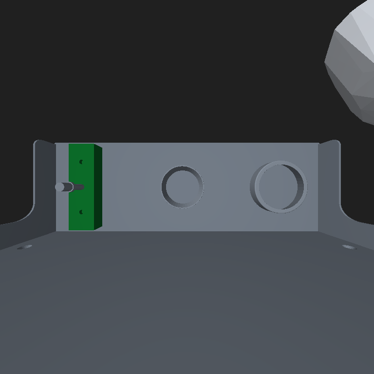

# 고정 공급 배치 · 양팔 CaP 최단시간 실험

현재 최우선 목표는 기존 M80 앞 선반에서 왼쪽부터 **핀 홀더 → 작은 링 → 큰 링**을 고정 위치에 놓고, 왼손이 전달받아 운반·삽입하는 동안 오른손이 다음 부품을 집도록 만드는 것입니다. native Franka Hand·원래 FR3 제한을 유지하고 촬영·RGB-D 인식·계산·동작을 모두 시간에 포함합니다. 랜덤 바구니 시험과 구분된 새 실험입니다.

기존 선반 CAD 지지면은Z0.884313439m입니다. 최신430 배치는 PIN[.230,−.855,.916063439], SMALL[.200,−.715,.891413439], LARGE[.230,−.575,.892163439]m이며 로봇 장면 WORLD 좌표입니다. 현장의 로봇 BASE 좌표로 그대로 사용하면 안 됩니다. 사진에서 제안했던 초록색 홀더 대리 모델을 옮겼으며 치수는 실측 검증 전입니다. 작은 링은 앞면UP, 큰 링은DOWN으로 실제 초기 배치해 안정적 파지·전달/직접 삽입 역할을 나눕니다. 초기화 뒤 물체 위치를 수정하거나 부착하지 않습니다.

실제427 시뮬 RGB-D에서 두 크기와 앞뒤를 자동 검출했습니다. **후속432는 링 두 개·핀 하나의 물리 삽입·고정 유지·양손 철수를 전체 통과했습니다. 촬영·인식·계산·동작 포함302.66초 /시뮬 물리48.31초입니다.**20/30초·실기는 미검증이며 더 최적화 중입니다. [정확한432 코드·입력·평가·프로파일](simulation_checkpoint_20261022/experiments/fixed-front432-pass/README.md).

왼손에0.25초 선행을 준 뒤 작은 링 운반과 오른손 큰 링 접근을 실제로 겹쳤습니다. 이 버전은 오른손이 닫히기 전에 왼손 작업을 마칩니다. 왼손 삽입 중 오른손 **파지·상승까지** 겹치는 후속 정책은 별도 시험 중이며432의 성과로 주장하지 않습니다. 실제 로봇이 연결된 시험은 아닙니다.

[전체 통과 실제 기록 영상: 동작1배속·긴 대기CUT·전체 원본302.66초 표시](simulation_checkpoint_20261022/media/fixed-front432-all3-pass-excerpts-1x.mp4).

이전430은 작은 링 전달 뒤 동시 경로 검사에서 멈췄습니다. [원본 실패 기록](simulation_checkpoint_20261022/experiments/fixed-front430/README.md)을 보존했습니다.

이 연구 checkpoint는 서버 CAD·Isaac·GPU 서비스가 필요합니다. 기존 [현장 패키지](FIELD_RGBD_20261022.md)는 별도의 실험용 RGB-D/실제 SDK 도구이며, 최신 동시 정책이 실기에 모두 포팅됐다는 뜻이 아닙니다. 현장은 보정·실제 연결·단품 시운전이 필요합니다.

## 실제 RGB-D 카메라 입력 도구

[고정 배치용 RealSense 인식 어댑터](fixed_front_rgbd_adapter_20261022/README.md)는 기존608 패키지를 별도 폴더로 복제한 뒤 설치합니다. 시뮬레이션에서 쓰던 링 크기·앞뒤·중심·축 검출기를 실제 RGB-D 픽셀·SDK 점군·보정한 외부 파라미터에 연결하는 opt-in 도구입니다. 네 개의 실제432 시뮬 촬영 입력을 설치된 CLI에 넣어 기존 결과와 일치함을 확인했습니다. 물리 카메라·로봇 연결 시험이나 전체 조립 성공을 뜻하지 않으며, 이 명령은 로봇·PLC를 움직이지 않습니다. 기존608 실행 파일은 수정하지 않습니다.

## 저장 경로와 비전 보정

[실제443 코드·검증 결과](simulation_checkpoint_20261022/experiments/fixed-cache443/README.md): 큰 링의 고정 운반 경로를 사전 검증해 저장했고, 실행 때 RGB-D 집기 보정과 새 연결 구간을 검사한 뒤 그대로 재사용했습니다. 실제 고정 설비 검사7085건이 재사용됐습니다. 두 링 삽입까지 통과한 뒤 PIN 촬영 가림으로 멈췄으므로 전체 성공 기록은 여전히432입니다. 작은 링 저장 경로와 PIN 시점 보정을 후속 전체 시험에 통합 중입니다.
