# 카메라 설치: 바구니 위 시야와 파지·전달·삽입 시야

**바구니는 위에서 내려다보는 고정 카메라로 먼저 맞추고, 손에 든 링의 원형 면과 삽입 직전 부품이 보이는 별도 시야를 확보합니다.** 카메라 한 대로 바구니·전달·지그의 모든 장면을 본다고 전제하지 않습니다. 실제 장비의 모델·렌즈·최소 동작 거리·해상도는 아직 확인되지 않았습니다. 아래 거리와 각도는 설치 후보를 찾는 **공학적 시작값**이며, 제조사 사양이나 검증된 실기 설정이 아닙니다.

이 문서의 사진은 `native-roas-table-scatter-speed-v128-closer-transfer-445` 성공 실행에서 저장한 **시뮬 RGB-D의 RGB 채널**입니다. 실제 현장 설치 사진이 아닙니다. 같은 실행에도 인식 실패 사진이 있으며, 시뮬은 가상 카메라의 위치와 확대율을 바꾸어 다시 촬영했습니다. 실기에서는 고정 설치한 카메라와 실측한 보정으로 같은 가시성을 만들어야 합니다.

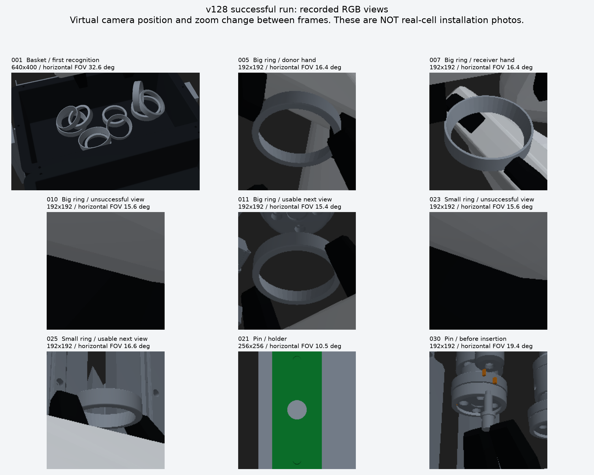

그림의 원본 NPZ 경로·해시·관측 번호·내부 행렬·가상 카메라 위치는 [촬영 근거](assets/camera/capture-provenance.json)에 있습니다. 녹색 검출 표시가 있는 별도 `*-source-overlay.png`는 원본 실행이 저장한 마스크 표시입니다. 컬러 영상에서 링이 보이는 것과 실제 센서의 깊이가 유효한 것은 따로 확인합니다.

## 1. 설치 역할과 필요한 대수

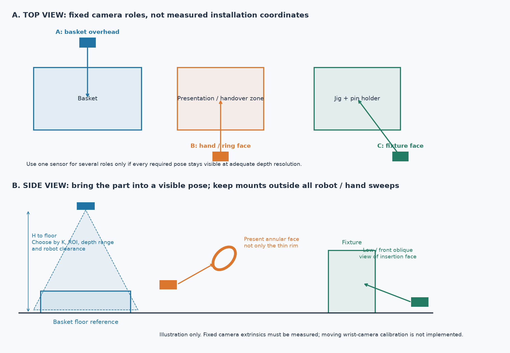

이 배치도는 역할을 나누는 예시이며 실제 셀의 치수·좌표·필요 대수를 측정한 도면이 아닙니다. 카메라 본체와 케이블도 실제 팔·손의 이동 범위 밖에 고정합니다.

| 역할 | 주로 볼 곳 | 카메라가 반드시 확인할 모습 | 설정 역할 이름 |
|---|---|---|---|
| 바구니 | 바구니 전체와 집기 진입부 | 네 모서리·바닥·노출된 두 크기 링, 로봇이 대기해도 유지되는 시야 | `basket` |
| 오른손 파지·전달 | 들어 올린 부품과 양손 전달 위치 | 손바닥에 가리지 않은 링의 원형 면·안쪽 경계, 전달 직전/받는 손 접근 후에도 남는 면 | `held_right` |
| 왼손 파지·삽입 | 전달 후 왼손, 지그 접근·삽입 직전 | 반대편에서 보이는 링 면, 지그/손가락과 분리되는 깊이, 설치 후 부품 | `held_left` |
| 핀 홀더 | 실제 핀 공급 홀더 | 핀 끝면과 단계가 충분한 픽셀로 보이는 근접 시야 | `pin_holder` |

우선 **바구니용 1대 + 전달/지그용 1대**의 두 고정 시야로 가능한지 확인합니다. 두 번째 카메라가 양손 접근 후나 지그 앞에서 가려지면 반대쪽 카메라를 추가하여 **바구니·전달·지그의 세 고정 시야**로 나눕니다. 핀 홀더까지 해상도와 시야를 충족하지 못하면 홀더용 시야가 더 필요합니다. 네 역할이 곧 네 대라는 뜻은 아닙니다. 실제 모든 필수 자세에서 보이는지를 보고 역할을 공유합니다.

카메라를 손목에 달아 움직이는 방식은 이 패키지의 현재 실행기가 자동 보정하지 않습니다. 같은 일련번호의 카메라를 역할마다 다른 위치에 있다고 설정해도 물리적 시야가 생기지 않습니다. 고정 장착 위치가 바뀌면 외부 보정을 다시 측정합니다.

## 2. 바구니 위 카메라를 먼저 맞추기

렌즈를 바구니 중심선 위에 두고, 긴 변이 영상의 긴 방향을 사용하도록 배치합니다. 첫 설치 후보는 바닥에서 렌즈까지 수직 높이 **약 0.45–0.80m**, 수직 아래 방향에서 **0–15° 정도 기울인 위치**입니다. 해당 모델의 최소 동작 거리와 픽셀 조건을 충족할 때만 이 범위를 사용합니다. 반사가 심하면 조명 방향과 작은 기울기를 조정하되, 벽 뒤 바닥이 가려지는지 다시 봅니다.

높이를 정하는 순서는 다음과 같습니다.

1. 바구니 바닥 네 모서리와 벽 전체, 링이 튀어나올 수 있는 범위가 RGB와 깊이 양쪽에 들어오게 합니다.
2. 로봇을 실제 대기·집기 준비 자세에 놓아 팔·손목이 바구니를 가리는지 확인합니다. 빈 테이블에서만 잘 보이는 위치로 끝내지 않습니다.
3. 작은 링을 바구니의 앞·뒤·좌·우·중앙에 놓고, 기울거나 겹친 경우에도 노출된 원형 면을 검출하는지 확인합니다. 모든 가려진 링을 볼 수 있다는 뜻은 아닙니다.
4. 바구니가 영상 너비의 대략 70–85%를 사용하도록 후보를 조정합니다. 가장자리 깊이 누락과 이동 여유 때문에 영상에 꽉 붙이지 않습니다. 최종 조건은 아래 픽셀 계산과 실제 검출 결과입니다.

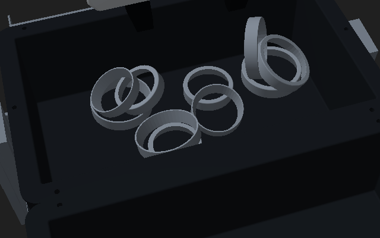

이 시뮬 사진은 정수직 시야가 아닙니다. 바구니 바닥 원점에서 가상 카메라까지 셀 좌표의 수평 거리가 약 0.418m, 높이 차이가 0.65m이고, 바닥 원점보다 25mm 높은 지점을 향해 **셀 수직축에서 약 33.75°** 기울어져 있습니다. 바구니 바닥 자체의 기울기는 별도입니다. 640×400 영상의 `fx=fy≈1093.35`이므로 수평 화각은 약 **32.6°**입니다. 이 수치를 넓은 화각의 실제 카메라에 그대로 적용하면 링이 훨씬 작게 보일 수 있습니다. 현장은 위 설치 후보에서 전체 바닥 가시성과 실제 픽셀 수를 보고 정합니다.

바구니 벽이나 겹친 링 뒤가 보이지 않으면 그 영역은 미관측입니다. 검출 실패는 빈 바구니 확인이 아닙니다. 선택 기능인 `basket.unrecognized_scene_enclosure`를 쓰려면 바구니와 돌출 적재물 전체를 감싸는 실제 영역을 측정해야 하며, 그 영역은 전부 장애물로 취급됩니다. 이 대안은 집기 대상을 만들지 않습니다.

## 3. 전달용 카메라는 링의 면이 보이는 쪽에 두기

링의 바깥 원통 옆면만 보이면 중심 일부를 추정할 수 있어도 앞뒤 방향을 안정적으로 구분하기 어렵습니다. 이 검출기는 보이는 원형 띠의 안쪽 반경 차이로 축의 부호를 판단하므로 **바깥 테두리와 안쪽 경계가 함께 보이는 원형 면**이 필요합니다. 링의 축 주위 회전각은 관측되지 않으며, 그 값까지 측정했다고 취급하지 않습니다.

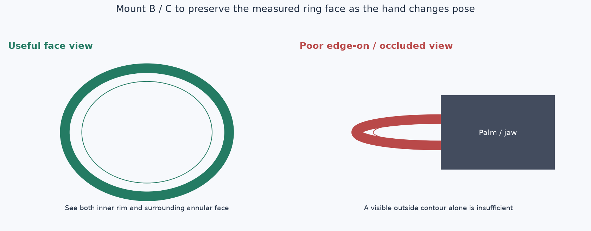

전달 지점을 바라보는 앞쪽 또는 옆쪽 고정 카메라를 후보로 잡습니다. 렌즈–부품 거리는 **약 0.30–0.60m**, 보는 방향과 링 면의 법선 사이 각도는 우선 **0–45°**를 목표로 비교합니다. 모델의 동작 거리와 실제 해상도가 허용해야 합니다. 손바닥과 반대편의 노출된 면을 우선 보되, 받는 손이 들어온 뒤의 가림까지 확인합니다. 이 각도는 품질 좋은 후보를 찾는 시작값이며, 검출기의 보장 범위가 아닙니다.

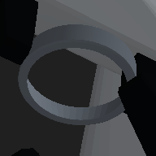

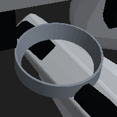

위 두 사진은 링 면을 확인하기 위해 가상 카메라가 다른 위치에서 촬영한 결과입니다. 각각 192×192이지만 `fx≈665.38`, 수평 화각 약 **16.4°**의 좁은 시야이며, 링까지의 거리는 약 **0.35m**입니다. 실제 광각 카메라의 192픽셀 영상과 동등한 해상도라고 볼 수 없습니다. 작은 저장 영상이라는 이유로 실제 입력을 192픽셀로 낮추지 않습니다.

카메라 수를 줄여야 한다면, 고정 카메라가 잘 보는 측정된 전달 위치에서 부품을 제시하는 방법을 먼저 검토합니다. 그 위치까지 가는 로봇 경로와 양손 여유는 별도로 현장 검증해야 합니다. 시뮬의 가상 카메라 이동을 실제 카메라 이동 없이 재현했다고 처리하지 않습니다.

## 4. 지그 앞에서는 아래쪽·반대쪽 시야를 따로 확인하기

지그에 접근하면 손목·손바닥·클램프가 링을 가릴 수 있습니다. 바구니 상부 카메라가 잘 작동해도 이 단계의 관측을 대신하지 못합니다. 지그의 앞 또는 옆에서 부품의 노출 면을 보는 카메라를 두고, 필요하면 지그보다 낮은 쪽에서 비스듬히 올려다보는 위치도 비교합니다. 렌즈–부품 거리 **약 0.25–0.50m**를 후보로 삼되, 모델 최소 거리·팔/공구 경로·테이블 가림을 먼저 확인합니다.

| 같은 실행의 실패한 시야 | 다음에 사용할 수 있었던 시야 |
|---|---|
| 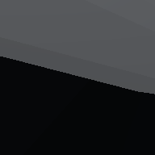 | 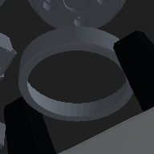 |
| 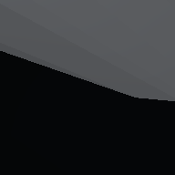 | 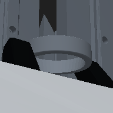 |

실패 사진은 물체가 없는 영상이 아니라 부품을 측정할 면이 가려진 영상입니다. v128의 삽입 보정 코드는 부품 아래쪽을 포함한 서로 다른 가상 위치에서 최대 세 번 촬영했습니다. 현장에서는 그중 실제로 가능한 시야를 고정 카메라로 확보하고, **전달 직후·삽입 직전·손 개방 후** 세 자세에서 각각 확인합니다. 한 자세에서만 잘 보이면 전체 단계의 시야 확인은 끝나지 않은 것입니다.

시뮬의 왼손 영상 처리에는 고정 CAD로 만든 빈 지그 깊이 배경을 사용하는 부분도 있습니다. 실제 센서에서 같은 이상적인 깊이나 자동 배경 분리가 생긴다고 가정하지 않습니다. 현재 실기 입력은 센서가 측정한 RGB-D와 SDK의 픽셀별 XYZ입니다.

## 5. 핀 홀더와 손에 든 핀은 서로 다른 장면

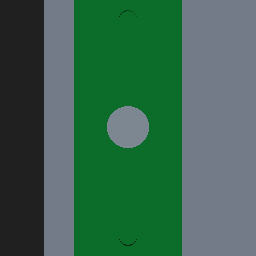

홀더에서는 핀 끝면을 가까이 봅니다. v128 관측 021은 약 0.434m 거리에서 256×256, `fx≈1388.8`, 수평 화각 약 **10.5°**인 가상 카메라입니다. 바구니 전체를 보는 실제 광각 영상에서 작은 핀 끝면도 같은 크기로 보일 것이라고 가정하지 않습니다. 핀 홀더가 바구니 카메라의 구석에 작게 찍히면 별도 근접 시야를 검토합니다.

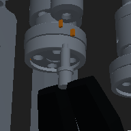

파지 후에는 핀의 길이 방향과 단계가 손·지그에 묻히지 않는 비스듬한 시야가 필요합니다. 끝면만 보이는 홀더 시야와 같은 조건이 아닙니다. 패키지는 홀더에서는 실측한 핀 홀더 주변을 탐색하고, 파지 후에는 이전 카메라 관측과 실제 TCP로 만든 탐색 초기값을 이용해 **현재 RGB-D로 다시 정합**합니다. 처음 홀더에서 얻은 위치를 손에 든 핀의 실제 위치로 계속 사용하지 않습니다.

## 6. 실제 렌즈와 픽셀 수로 거리 정하기

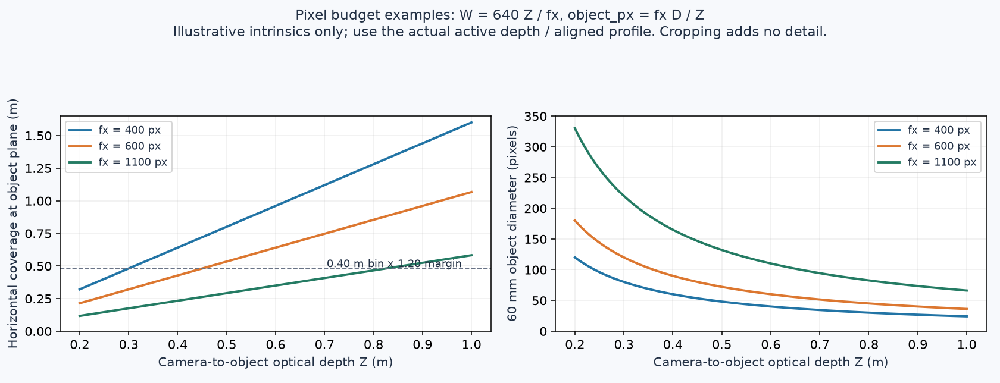

그래프는 너비 640픽셀, 가상의 `fx=400/600/1100px`, 지름 60mm 물체를 비교한 예입니다. 0.40m 영역에 20% 여유를 둔 선도 실제 바구니 치수와 카메라의 측정값으로 바꿔 판단합니다. 본 작업의 명목 링 지름은 약 75mm와 62mm입니다.

설치 후보를 계산할 때만 다음 근사를 사용합니다. `fx`는 해당 스트림의 실제 픽셀 단위 초점 거리, `Z`는 카메라 광축 방향 깊이(m), `D`는 물체 지름(m)입니다.

```text
정면에 가까운 원의 지름 픽셀 수 ≈ fx × D / Z
기울어진 원의 짧은 방향 크기 ≈ 위 값 × cos(면 기울기)
중앙 부근 수평 화각 ≈ 2 × atan(영상 너비 / (2 × fx))
```

예를 들어 **가상의** `fx=600px`, `Z=0.60m`이면 75mm 링은 약 75px, 62mm 링은 약 62px입니다. `fx=1200px`인 실제 지원 프로파일이라면 같은 거리에서 약 두 배입니다. 이는 특정 카메라 제품의 사양이 아닙니다. 왜곡·가림·기울기·유효 깊이 손실도 빠진 계산입니다. 내부 행렬과 왜곡 모델은 SDK가 보고한 실제 값을 사용합니다. [OpenCV 카메라 모델](https://docs.opencv.org/4.x/d9/d0c/group__calib3d.html)

첫 비교 목표로는 큰 링 지름 약 **100px 이상**, 작은 링 약 **80px 이상**, 보이는 얇은 원형 띠 폭 **4–6개의 실제 깊이 표본 이상**을 잡아 봅니다. 이 수치는 설치 후보를 거르는 공학적 목표이며, 소프트웨어 통과 기준이나 성공 보장이 아닙니다. 두께가 2mm 정도인 면을 바구니 전체 640픽셀 영상에서 이 정도로 표현하기 어려울 수 있습니다. 그러면 실제 지원하는 더 높은 깊이 해상도나 더 가까운 별도 시야가 필요한지 검토합니다. RGB 확대나 정렬 과정의 보간은 독립적인 깊이 표본을 늘리지 않습니다.

현재 수집기는 기본적으로 **640×480 RGB-D / 30fps**를 요청합니다. 제조사 Viewer에서 다른 고해상도 모드를 확인해도 이 실행기가 자동으로 그 모드를 사용하는 것은 아닙니다. 지원되지 않는 요청 모드는 실제 SDK에서 거절됩니다. 모델의 지원 모드·최소 거리·실측 픽셀 수를 먼저 확인하고, 프로파일을 바꾼 경우 코드 설정과 실제 수집 결과까지 다시 확인합니다.

## 7. 금속 반사와 깊이 품질 확인

금속 링은 색 영상에서 선명해도 깊이가 비거나 잘못된 곳에 나타날 수 있습니다. 한 장의 컬러 사진만 보고 설치 완료로 판단하지 않습니다. 깊이 오버레이와 클릭한 SDK XYZ가 링의 실제 표면을 따라가는지, 배경이나 손가락으로 붙지 않는지 봅니다. 직접 반사되는 조명 위치를 바꾸거나 확산 조명을 비교하고, 카메라를 조금 기울여 반복 촬영합니다. 실제 물체의 위치·재질을 바꾼 경우도 기록합니다.

RealSense 공식 문서는 반사로 인한 포화·깊이 구멍·잘못된 반사 깊이를 설명합니다. 또한 유리 등에 쓰는 편광 효과를 금속 반사에 그대로 적용할 수 없다고 구분합니다. 편광 필터만 붙이면 금속 핀 문제가 해결된다고 가정하지 않습니다. 필터나 보호판을 바꾸면 투과량과 정렬 품질도 확인해야 합니다. [RealSense 광학 필터 안내](https://dev.realsenseai.com/docs/optical-filters-for-intel-realsense-depth-cameras-d400/)

스테레오 깊이는 영상 대응점과 표면의 텍스처에 영향을 받습니다. 노출·프로젝터·거리·프로파일 조정은 해당 모델의 공식 도구로 비교합니다. 이 패키지의 원 검출기는 시뮬 깊이에 맞춘 약 **0.07–0.2mm 규모의 평면 문턱값**을 포함하므로, 실제 센서가 그 조건을 충족하는지는 별도 확인이 필요합니다. 노이즈 때문에 실패하는 결과를 임의 보간이나 자동 문턱 완화로 성공 처리하지 않습니다. [RealSense 깊이 조정 안내](https://dev.realsenseai.com/docs/tuning-depth-cameras-for-best-performance/)

## 8. 실제 고정 카메라 보정과 역할 연결

보정값은 **카메라 RGB 광학 좌표 → 공통 셀 좌표**의 변환입니다. 단위는 m입니다.

```text
p_cell = T_cell_camera @ p_camera
p_cell = T_cell_base_left @ p_left_base
p_cell = T_cell_base_right @ p_right_base
```

RealSense 광학 좌표는 x가 오른쪽, y가 아래쪽, z가 앞쪽입니다. RGB 센서·깊이 센서의 좌표가 서로 다를 수 있으므로 정렬된 깊이와 해당 SDK XYZ를 사용합니다. 이 패키지의 실기 검출기는 `points_camera_image_m`의 H×W×3 픽셀 대응을 사용하며, 펼친 N×3 점군이나 RGB 마스크를 픽셀 XYZ 대신 받지 않습니다. [RealSense 좌표·정렬·역투영 설명](https://github.com/realsenseai/librealsense/wiki/Projection-in-RealSense-SDK-2.0)

고정한 카메라마다 다음 순서로 진행합니다.

1. 카메라를 고정한 뒤 실측할 기준점을 바구니·전달·지그에서 실제 사용하는 범위에 분산합니다. 대응점은 최소 세 개의 비공선 점이 필요합니다. 실무 비교용으로는 6–10개 이상을 분산하고, 계산에 쓰지 않은 별도 점으로 확인하는 편이 좋습니다.
2. 카메라에서 읽은 실제 표면 점과 독립적으로 측정한 동일한 셀 좌표 점을 같은 순서로 저장합니다. 클릭한 표면 점을 링 중심이나 TCP로 간주하지 않습니다.
3. 아래 `calibration fit`으로 강체 변환을 구하고 실제 기준점에서 방향·거리·잔차를 확인합니다. 기본 잔차 제한 3mm는 계산 입력을 거르는 상한이며, 삽입 공차가 3mm라는 뜻이 아닙니다.
4. 각 역할의 `random-camera` 설정에 실제 일련번호·`T_cell_camera`·같은 셀/양팔 기저 좌표·측정 기록을 넣습니다. 바구니 바닥·정상 방향·영역, 파지 중 관측 작업 영역, 필요한 핀 홀더 위치도 실측합니다. 링의 초기 위치는 넣지 않습니다.

`calibration fit`은 대응 3D 점의 강체 정합 도구입니다. 렌즈 내부 보정이나 움직이는 손목 카메라의 hand-eye 보정을 자동으로 수행하지 않습니다. OpenCV의 내부 보정과 hand-eye 보정도 서로 다른 입력·변환 문제입니다. [OpenCV 보정 API](https://docs.opencv.org/4.x/d9/d0c/group__calib3d.html)

역할 파일의 예시는 다음과 같습니다. 경로는 현장 레시피 폴더를 기준으로 맞추며, 실제 같은 고정 카메라가 두 역할을 볼 수 있을 때만 파일을 공유합니다. `random-cycle.json`과 `random-motion.json`에서 허용하는 역할별 카메라 파일을 함께 맞춥니다.

```json
{
  "camera_configs": {
    "basket": "camera-basket.json",
    "held_right": "camera-transfer.json",
    "held_left": "camera-fixture.json",
    "pin_holder": "camera-holder.json"
  }
}
```

서로 다른 카메라의 관측을 연결하려면 공통 `cell_frame`과 양팔 기저 보정이 같아야 합니다. 일련번호나 파일 이름만 맞추는 것으로 좌표 보정이 되지 않습니다.

## 9. 현장에서 실행하는 카메라 확인 명령

패키지 루트에서 시작합니다. 명령의 `ACTUAL_SERIAL`은 실제 검색 결과로 바꿉니다.

현장 설정을 아직 만들지 않았다면 먼저 `./field-demo init-random --output site/random`을 한 번 실행합니다. 이미 실측값을 기록한 폴더에는 다시 초기화하지 않습니다. 생성된 `random-camera.json`을 실제 고정 카메라마다 별도 파일로 복사해 아래 예의 `camera-basket.json`·`camera-transfer.json`·`camera-fixture.json`·`camera-holder.json` 이름과 역할 설정을 맞춥니다. 한 실제 카메라로 여러 역할을 확인한 경우에는 같은 파일을 참조할 수 있습니다.

```bash
./field-demo camera list

./field-demo camera sample --serial ACTUAL_SERIAL \
  --output reports/camera-A-first.npz

./field-demo preview --snapshot reports/camera-A-first.npz \
  --output reports/camera-A-first.html
```

HTML을 열어 RGB와 깊이 오버레이를 보고 표면 점을 클릭합니다. 복사되는 값은 실제 SDK의 카메라 좌표입니다. 유효하지 않은 깊이는 거부됩니다. 이 원시 샘플은 `UNMEASURED`로 표시되며 운동이나 보정 완료의 근거로 자동 승인되지 않습니다.

대응점 JSON에는 `units:"m"`, 같은 길이의 `points_camera_m`, `points_cell_m` 배열을 넣습니다. 각 배열의 같은 행이 동일한 물리적 점이어야 합니다.

```bash
./field-demo calibration fit \
  --correspondences site/random/camera-A-points.json \
  --output site/random/camera-A-fit.json
```

실제 측정을 확인해 역할별 설정 파일을 채운 다음 바구니를 촬영합니다.

```bash
./field-demo random-vision observe \
  --config site/random/camera-basket.json \
  --output reports/basket-live.json \
  --session-dir reports/camera-basket-001 --frames 3

./field-demo random-vision observe \
  --config site/random/camera-holder.json --scope pin_holder --part pin \
  --output reports/pin-holder-live.json \
  --session-dir reports/camera-holder-001 --frames 3

./field-demo random-cycle --recipe site/random/random-cycle.json --validate
```

관측 세션 폴더는 매번 새 빈 폴더를 사용합니다. `--frames 0`은 Ctrl-C까지 연속 관측입니다. 관측 실패 시 최신 결과에서 이전 타깃이 제거됩니다. 노출 시각과 현재 영상의 신선도는 메타데이터에서 검사하므로, 파일의 시각을 고쳐 오래된 영상을 새 영상으로 만들지 않습니다.

현재 단독 `random-vision observe` 명령의 시야 선택은 `basket`과 `pin_holder`입니다. 손에 든 부품의 재정합은 `random-cycle`이 실제 TCP·이전 카메라 관측·파지 관계와 함께 호출합니다. 설치 중에는 실제 시험 자세에서 `camera sample`과 미리보기로 가시성을 먼저 확인하고, 개별 저속 파지·전달 확인 시 현재 이미지 정합 결과까지 확인합니다.

## 10. 여러 카메라를 연결할 때

먼저 한 대씩 검색·수집·깊이를 확인하고, 다음에 모두 켠 상태에서 같은 검사를 반복합니다. 가능하면 실제 USB 3 연결과 전원·케이블 상태를 확인하고, 동시에 켰을 때 프레임 누락·대기열 지연·깊이 품질이 나빠지지 않는지 봅니다. RealSense D4xx의 공식 다중 카메라 자료는 겹치는 시야 운용을 다루지만 USB 대역폭·전원·CPU·지연·배선 제약도 명시합니다. 이 특성을 모델을 모르는 다른 방식의 깊이 카메라에 일반화하지 않습니다. [RealSense 다중 카메라 안내](https://dev.realsenseai.com/docs/multiple-depth-cameras-configuration/)

각 카메라의 일련번호·고정 좌표·역할·노출 시각을 별도로 기록합니다. 하드웨어 동기화나 여러 점군의 자동 융합이 이 실행기에 추가되어 있다고 가정하지 않습니다. 역할별 촬영이 모두 현재 실제 영상인지 확인합니다.

## 11. 설치 완료 판단

| 실제 시험 자세 | 확인할 결과 |
|---|---|
| 양팔 대기 + 바구니 앞/뒤/중앙의 링 | 필요한 링 크기의 실제 검출, 충분한 면·안쪽 경계, 깊이 누락·벽 가림 확인 |
| 오른손 파지 후 상승 | 현재 영상으로 부품과 손-부품 관계 재측정 |
| 전달 전 + 받는 손이 접근한 상태 | 두 자세 모두 면이 보이고 현재 영상에서 재정합 성공 |
| 왼손 전달 완료 | 다른 손·다른 카메라여도 공통 셀 좌표에서 다시 측정 |
| 지그 접근 + 삽입 직전 | 손목·클램프에 가리지 않은 면과 부품 깊이 유지 |
| 손 개방 후 철수 전 | 설치된 부품을 고유하게 관측하고 실제 지그 신호와 함께 확인 |
| 홀더 핀 + 파지 후 핀 | 홀더 끝면과 파지 후 길이/단계가 각각 충분히 보임 |
| 모든 카메라 동시 연결 | 개별 시험과 같은 깊이·프레임 신선도, 일련번호/좌표 혼동 없음 |

각 자세의 RGB-D와 결과 JSON을 남깁니다. 정지한 같은 부품을 여러 번 관측해 중심·축의 변동과 실제 기준점 오차를 기록합니다. 한 번의 인식 성공만으로 내일의 세 부품 조립이 검증되지는 않습니다. 이 문서는 실제 장비를 설치하고 시야·깊이·보정을 확인하는 절차이며, 현장 조립·반복 성공률·실기 시간을 대신하지 않습니다.
